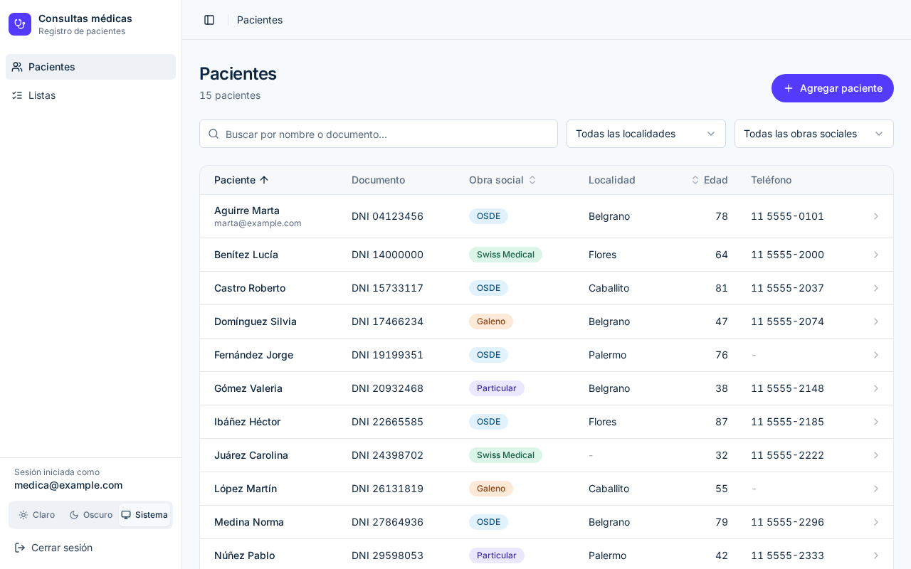
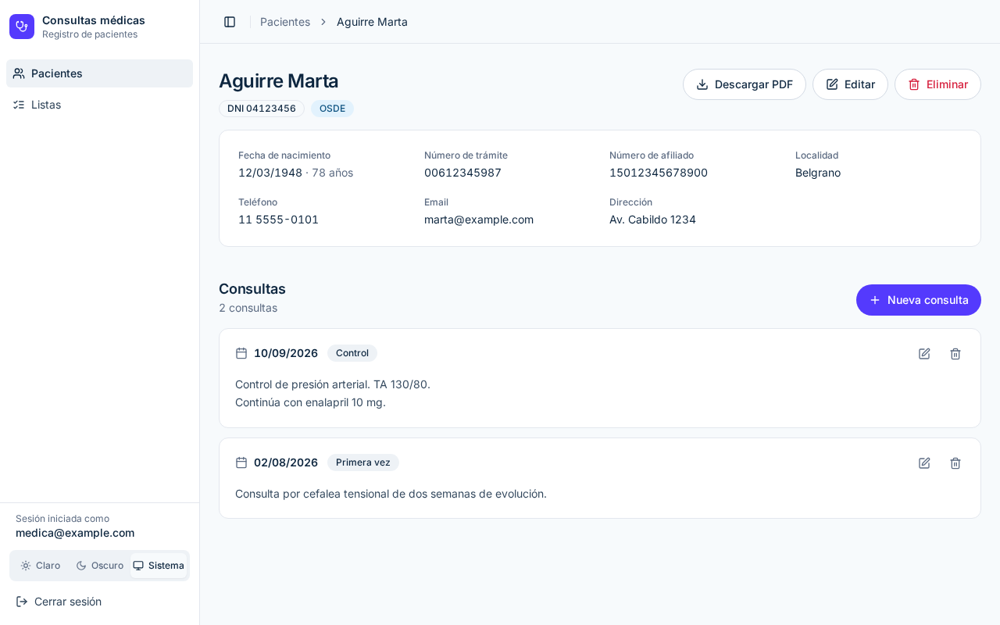
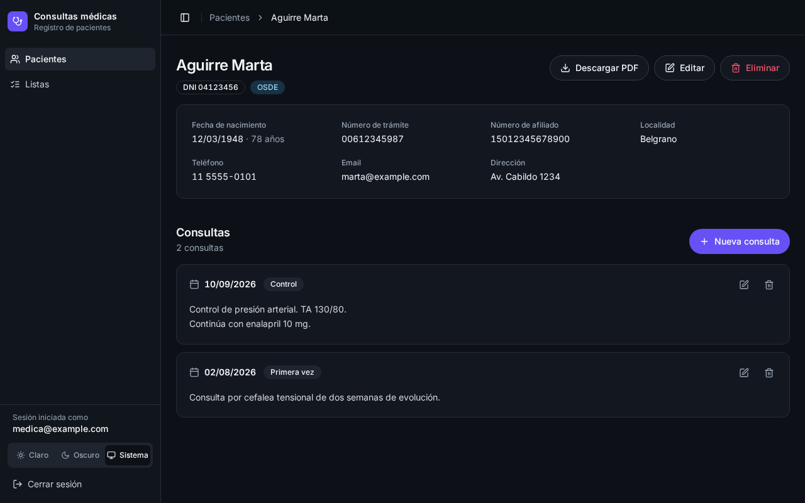
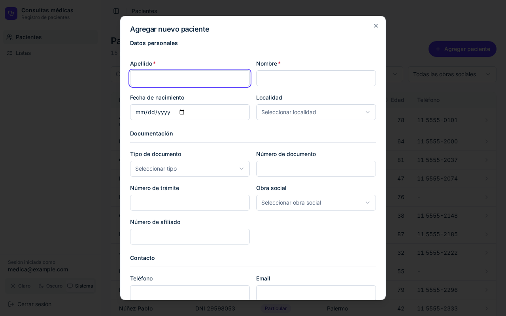
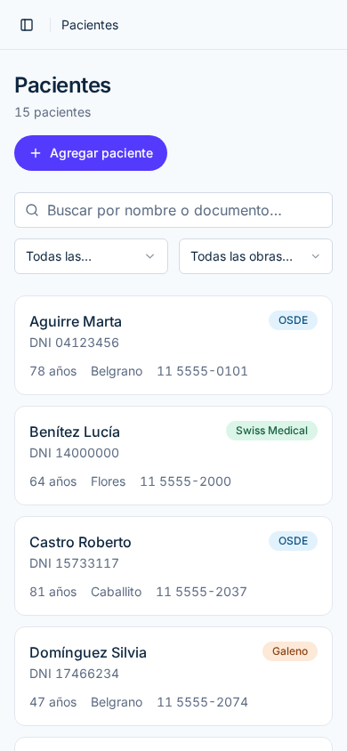
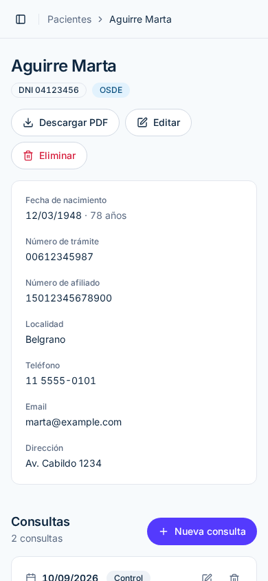
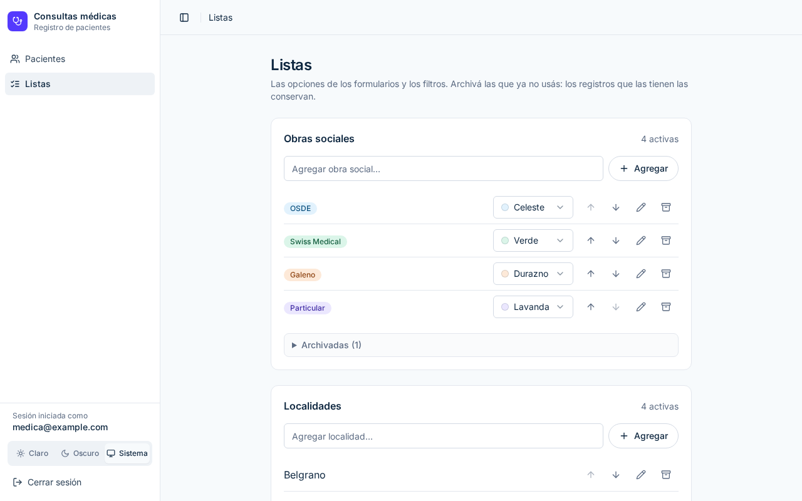

# Medical Records — Consultas médicas

[](https://github.com/ianpandis/medical-records/actions/workflows/ci.yml)
[](LICENSE)

> **English:** A small web app for doctors to keep a patient registry and consultation notes, and export each patient's clinical history as a PDF (React + Vite + Supabase, Spanish UI).

Aplicación web para que un profesional de la salud lleve el **registro de sus pacientes y de sus consultas**, y descargue la **historia clínica de cada paciente en PDF**. La interfaz está en español (Argentina), se ingresa con Google y cada usuario ve solamente sus propios datos.

---

## Índice

- [Funcionalidades](#funcionalidades)
- [Capturas](#capturas)
- [Stack](#stack)
- [Arquitectura](#arquitectura)
- [Requisitos](#requisitos)
- [Instalación paso a paso](#instalación-paso-a-paso)
- [Scripts](#scripts)
- [Tests](#tests)
- [Deploy](#deploy)
- [Estructura del proyecto](#estructura-del-proyecto)
- [Personalización](#personalización)
- [Aviso legal](#aviso-legal)
- [Licencia](#licencia)

## Funcionalidades

**Pacientes**
- Alta, edición y baja de pacientes. Al borrar un paciente se borran también sus consultas (en una sola operación).
- Datos: nombre, apellido, tipo y número de documento (DNI, LE, LC), número de trámite, obra social, número de afiliado, fecha de nacimiento (con edad calculada), teléfono, email, dirección y localidad. Los números se guardan como texto para no perder ceros a la izquierda.
- Listado en tabla con búsqueda por nombre o documento, filtros por localidad y obra social, orden por columna (paciente, edad, obra social) y paginación de a 50.
- Los filtros, el orden y la página quedan en la URL: podés recargar o compartir el link y ves lo mismo.

**Consultas**
- Registro de consultas por paciente con fecha, tipo y notas libres.
- Edición y borrado de consultas.

**Listas configurables**
- Cada profesional arma sus propias listas de **obras sociales**, **localidades** y **tipos de consulta** desde la pantalla *Listas*: agregar, renombrar, reordenar, elegir el color del badge de cada obra social y archivar las que ya no usa.
- Renombrar una opción la actualiza en todos los pacientes y consultas que la usan. Una opción en uso no se puede borrar: se archiva, deja de ofrecerse en los formularios y los registros la conservan.

**Historia clínica en PDF**
- Desde el detalle del paciente se descarga un PDF (A4) con sus datos y todas sus consultas. Se genera en el navegador; no se envía a ningún servidor.

**Experiencia de uso**
- Ingreso con Google (OAuth). No hay usuario y contraseña.
- Tema claro, oscuro o según el sistema.
- Aviso antes de descartar cambios sin guardar en un formulario.
- Mensajes de error que dicen qué pasó y qué hacer.
- Diseño responsive con menú lateral y revisión de accesibilidad.

## Capturas

Todas con datos ficticios.



| Detalle del paciente | Modo oscuro |
| --- | --- |
|  |  |

| Alta de paciente | Celular |
| --- | --- |
|  |   |

| Listas configurables |
| --- |
|  |

Se regeneran con `npm run screenshots`, que usa el mismo Supabase simulado que los tests e2e.

## Stack

| Capa | Tecnología |
| --- | --- |
| UI | React 18, TypeScript, React Router |
| Build / dev server | Vite 5 |
| Estilos y componentes | Tailwind CSS, shadcn/ui (Radix UI), lucide-react |
| Datos del servidor | TanStack Query (React Query) |
| Formularios | react-hook-form + zod |
| Backend | Supabase (PostgreSQL + Auth + Row Level Security) |
| PDF | @react-pdf/renderer |
| Fechas | date-fns |
| Tests e2e | Playwright |

## Arquitectura

Es una SPA estática: no hay un backend propio. El navegador habla directamente con Supabase usando la clave pública (publishable / anon), y la seguridad la pone la base de datos con **Row Level Security (RLS)**.

```
┌──────────────────────────┐        HTTPS         ┌──────────────────────────────┐
│  Navegador (SPA React)   │ ───────────────────▶ │  Supabase                    │
│  - React Query           │   clave publishable  │  - Auth (Google OAuth)       │
│  - PDF generado acá      │ ◀─────────────────── │  - PostgreSQL + RLS          │
└──────────────────────────┘                      │    patients / consultas /    │
                                                  │    listas configurables      │
                                                  └──────────────────────────────┘
```

- Cada fila de `patients`, `consultas` y de las listas configurables (`obras_sociales`, `localidades`, `tipos_consulta`) tiene un `user_id`, y cada usuario tiene su perfil en `users` (lo crea un trigger al registrarse). Las políticas RLS permiten leer y escribir solo las filas donde `auth.uid() = user_id`, y una consulta solo puede asociarse a un paciente propio. Aunque dos profesionales usen la misma instancia, ninguno ve los datos del otro.
- La clave publishable (anon) está pensada para ir en el frontend: por sí sola no da acceso a nada que RLS no permita.
- **Nunca pongas la clave `service_role` (o una secret key) en el frontend ni en variables `VITE_*`**: esa clave saltea RLS y daría acceso a todos los datos.

## Requisitos

- Node.js 20 o superior (recomendado 22, está en `.nvmrc`) y npm.
- Una cuenta de [Supabase](https://supabase.com) (el plan gratuito alcanza) con un proyecto creado.
- Un proyecto en [Google Cloud](https://console.cloud.google.com) para crear las credenciales OAuth.

## Instalación paso a paso

### 1. Clonar e instalar dependencias

```bash
git clone https://github.com/ianpandis/medical-records.git
cd medical-records
npm install
```

### 2. Variables de entorno

```bash
cp .env.example .env
```

Completá en `.env` los datos de tu proyecto (en Supabase: **Project Settings → API**):

| Variable | Valor |
| --- | --- |
| `VITE_SUPABASE_URL` | `https://<ref>.supabase.co` |
| `VITE_SUPABASE_PUBLISHABLE_KEY` | La clave publishable (o la anon key). También se acepta con el nombre `VITE_SUPABASE_ANON_KEY`. |

Si falta alguna, la app no arranca y muestra un error que indica cuál falta. `<ref>` es el identificador de tu proyecto (lo ves en la URL del dashboard de Supabase).

### 3. Crear la base de datos

Las tablas, restricciones y políticas RLS están en `supabase/migrations/`. Tenés dos formas de aplicarlas:

**Opción A — Supabase CLI (recomendada)**

```bash
npx supabase login
npx supabase link --project-ref <ref>
npx supabase db push
```

**Opción B — SQL Editor**

En el dashboard de Supabase, abrí **SQL Editor** y ejecutá el contenido de cada archivo de `supabase/migrations/`, uno por uno, **en orden por nombre** (el nombre empieza con la fecha). El primero tiene el schema completo y los siguientes son los cambios posteriores. La carpeta `supabase/migrations_legacy/` es solo historial: no la ejecutes.

### 4. Configurar el login con Google

La app solo permite ingresar con Google.

1. **Google Cloud Console** → *APIs & Services* → *OAuth consent screen*: configurá la pantalla de consentimiento (nombre de la app, email de soporte).
2. *APIs & Services* → *Credentials* → **Create credentials → OAuth client ID**:
   - Tipo: **Web application**.
   - *Authorized redirect URIs*: `https://<ref>.supabase.co/auth/v1/callback`
   - Guardá el **Client ID** y el **Client secret**.
3. **Supabase** → *Authentication* → *Providers* → **Google**: activalo y pegá el Client ID y el Client secret.
4. **Supabase** → *Authentication* → *URL Configuration*:
   - **Site URL**: `http://localhost:8080` (cuando hagas el deploy, cambiala por la URL de producción).
   - **Redirect URLs**: agregá `http://localhost:8080/**` y, cuando lo tengas, `https://tu-dominio.com/**`.

### 5. Levantar la app

```bash
npm run dev
```

Abrí <http://localhost:8080> e ingresá con Google.

Un usuario nuevo arranca con las listas de obras sociales, localidades y tipos de consulta **vacías**: cargalas desde **Listas** en el menú lateral antes de dar de alta pacientes.

### 6. Cerrar el registro

> [!IMPORTANT]
> Por defecto, **cualquier persona con una cuenta de Google podría registrarse** en tu instancia. RLS hace que no vea los datos de nadie más, pero en una app con datos clínicos lo correcto es que el registro esté cerrado.

1. En Supabase → *Authentication* → *Providers*, **desactivá el provider Email** (la app no lo usa).
2. Ingresá una vez con tu cuenta de Google para que se cree tu usuario.
3. En Supabase → *Authentication* → *Sign In / Providers* (o *Settings*, según la versión del dashboard), **desactivá "Allow new users to sign up"**. Desde ahí solo pueden entrar los usuarios que ya existen.
4. (Opcional) Si querés permitir solo ciertos emails en lugar de cerrar todo, podés armar una lista permitida con un [Auth Hook](https://supabase.com/docs/guides/auth/auth-hooks) de Supabase que rechace el alta de cualquier otro email.

## Scripts

| Comando | Qué hace |
| --- | --- |
| `npm run dev` | Servidor de desarrollo en <http://localhost:8080> |
| `npm run build` | Build de producción en `dist/` |
| `npm run build:dev` | Build en modo desarrollo |
| `npm run preview` | Sirve el build de `dist/` para probarlo localmente |
| `npm run lint` | ESLint |
| `npm run typecheck` | Chequeo de tipos de TypeScript de la app, la config de Vite y los tests (sin generar archivos) |
| `npm run test:e2e` | Tests end-to-end con Playwright |
| `npm run screenshots` | Regenera las capturas de `docs/screenshots/` y `public/og-image.png` |

## Tests

Los tests e2e están en `e2e/` y usan Playwright con Chromium:

```bash
npx playwright install chromium   # solo la primera vez
npm run test:e2e
```

Los tests **simulan Supabase** (sesión y respuestas de la API): no necesitan credenciales reales ni tocan ninguna base de datos.

## Deploy

La app es una SPA estática: el build (`npm run build`) genera la carpeta `dist/`, que se puede servir desde cualquier hosting estático. Como usa rutas del lado del cliente (por ejemplo `/patient/:id`), el hosting tiene que devolver `index.html` para cualquier ruta.

El repo ya trae la configuración para **Vercel** (`vercel.json`) y **Netlify** (`netlify.toml`): redirección de todas las rutas a `index.html` y headers de seguridad (`Content-Security-Policy`, `Strict-Transport-Security`, `X-Frame-Options`, `Referrer-Policy`, `X-Content-Type-Options` y `Permissions-Policy`). La CSP solo permite conexiones al propio sitio, a Supabase (`*.supabase.co`) y a Google Fonts.

- Si usás un proyecto común de Supabase no hace falta tocar nada.
- Si tu proyecto usa un dominio propio o sumás otro servicio externo (analytics, monitoreo de errores, imágenes de otro dominio), agregá ese dominio a la directiva que corresponda (`connect-src` para APIs y websockets, `img-src` para imágenes, `script-src` para scripts), con el mismo valor en los dos archivos.
- Si modificás el script inline de `index.html` que aplica el tema, recalculá su hash `sha256-…` en la CSP; si no, el navegador lo bloquea.
- Cualquier bloqueo aparece en la consola del navegador como un error de "Content Security Policy".

En ambos casos:

1. Configurá `VITE_SUPABASE_URL` y `VITE_SUPABASE_PUBLISHABLE_KEY` en las variables de entorno del hosting (se leen en el momento del build).
2. En Supabase → *Authentication* → *URL Configuration*, poné la URL de producción como **Site URL** y agregala en **Redirect URLs** (`https://tu-dominio.com/**`).

> [!TIP]
> Si vas a publicar una **demo pública**, usá un proyecto de Supabase separado y cargá solo **datos ficticios**. Nunca uses la instancia con datos reales para una demo.

## Estructura del proyecto

```
├── .github/                  CI (GitHub Actions) y templates de issues
├── docs/screenshots/         Capturas del README (datos ficticios)
├── e2e/                      Tests e2e (Playwright) con Supabase simulado
├── public/                   Archivos estáticos (favicon, robots.txt, og-image.png)
├── src/
│   ├── components/           Componentes de la app (listas, formularios, shell)
│   │   └── ui/               Componentes base de shadcn/ui
│   ├── hooks/                Auth, datos de pacientes (React Query), formularios
│   ├── integrations/supabase/ Cliente de Supabase y tipos de la base
│   ├── lib/
│   │   ├── patient.ts        Tipos, límites de texto, edad y orden del listado
│   │   ├── catalogos.ts      Listas configurables: nombres, colores de badge y opciones de los selects
│   │   └── historia-clinica-pdf.tsx  Generación del PDF
│   ├── pages/                Auth, Dashboard, PatientDetail, Listas, NotFound
│   └── App.tsx               Rutas y providers
├── supabase/
│   └── migrations/           Esquema de la base, políticas RLS, límites de tamaño y listas configurables
├── vercel.json, netlify.toml Deploy: rewrite de SPA y headers de seguridad (CSP)
└── .env.example              Variables de entorno necesarias
```

## Personalización

Las listas de **obras sociales**, **localidades** y **tipos de consulta** se editan desde la app, en **Listas**: no hace falta tocar código ni la base. Cada profesional tiene las suyas.

Por dentro, cada lista es una tabla (`obras_sociales`, `localidades`, `tipos_consulta`) con RLS por usuario. `patients.obra_social`, `patients.localidad` y `consultas.tipo` guardan el nombre de la opción y tienen una FK compuesta `(user_id, nombre)` hacia su lista, con `ON UPDATE CASCADE`: la base rechaza valores que no estén en la lista del profesional y propaga los renombres. Ver `supabase/migrations/20261021000000_listas_configurables.sql`.

Lo que sí es fijo en el código:

- **Tipos de documento** (DNI, LE, LC): un `enum` de la base (`tipo_documento`) y `TIPOS_DOCUMENTO` en `src/lib/patient.ts`.
- **Colores de los badges**: la paleta `TINTS` de `src/lib/catalogos.ts`, los tokens `--tint-*` de `src/index.css` y el `CHECK` de `obras_sociales.color`. Para sumar un color hay que cambiar los tres.

Si cambiás el esquema, regenerá los tipos de `src/integrations/supabase/types.ts` con `npx supabase gen types typescript --linked`.

## Aviso legal

> [!WARNING]
> Este software se ofrece **"tal cual", sin garantías de ningún tipo** (ver [LICENSE](LICENSE)).

- **No es un dispositivo médico** ni un sistema certificado de historia clínica electrónica.
- Quien lo instale y lo use es responsable de **cumplir la normativa aplicable**. En Argentina, entre otras: la **Ley 25.326** de Protección de Datos Personales (los datos de salud son **datos sensibles**) y la **Ley 26.529** de Derechos del Paciente, Historia Clínica y Consentimiento Informado. En otros países pueden aplicar el **GDPR** (Unión Europea), **HIPAA** (Estados Unidos) u otras normas.
- La **seguridad de cada instancia** (configuración de Supabase, registro cerrado, backups, accesos, hosting) es responsabilidad de quien la despliega.
- **No cargues datos reales de pacientes en demos** ni en entornos de prueba.

## Licencia

[MIT](LICENSE) © 2025-2026 Ian Pandis
